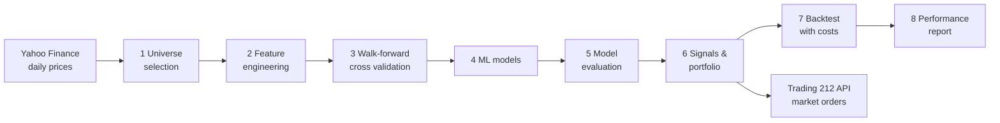

# Quant Trader

**An end-to-end systematic equity strategy: research, walk-forward machine learning, backtesting and automated trading through the Trading 212 API, running unattended on a cloud server.**

The project compares three ways of picking US large-cap stocks (a momentum factor, a mean-reversion factor, and a machine-learning model that blends both) using an 8-step research pipeline. It then trades the chosen strategy automatically in a Trading 212 Practice account.

> **Status:** demo (paper) trading since October 2026. Educational project, not financial advice.

---

## How it works



| Step | What happens | Code |
|---|---|---|
| 1 Universe selection | Each day, keep only liquid US large caps: price above $5, at least $20m traded a day, a year of history | `quantbot/universe.py` |
| 2 Feature engineering | 16 features: 12-1, 6-1 and 3-1 month momentum, 52-week-high distance, trend, short-term reversal, z-score, RSI, volatility, volume and market regime. Ranked cross-sectionally each day | `quantbot/features.py` |
| 3 Time series cross validation | Expanding-window walk-forward folds (3-year minimum train, 6-month test blocks), a purge gap equal to the prediction horizon, and a final 1-year holdout never used for model selection | `quantbot/cv.py` |
| 4 ML modelling | Logistic regression, random forest and gradient boosting, predicting whether a stock beats the cross-sectional median over the next 5 days | `quantbot/models.py` |
| 5 Model evaluation | AUC, daily rank IC, IC t-stat, top-minus-bottom quintile spread, decile returns and permutation feature importance. The model is chosen on development folds only | `quantbot/evaluation.py` |
| 6 Signals & portfolio | Top-N long-only portfolio, equal or inverse-volatility weights, a 15% position cap, and a hold buffer to cut turnover | `quantbot/signals.py` |
| 7 Backtest | Daily position drift, execution the day *after* the signal, and 0.20% cost per trade (Trading 212's 0.15% FX fee plus slippage) | `quantbot/backtest.py` |
| 8 Performance | CAGR, volatility, Sharpe, Sortino, max drawdown, Calmar, alpha/beta, turnover, cost drag and a self-contained HTML report | `quantbot/performance.py` |

**Live trading** (`run_live.py`, `quantbot/broker.py`) runs on a schedule on a DigitalOcean VPS. It:

- downloads fresh prices and scores the universe
- reads current holdings from the Trading 212 Public API
- sells first, waits for the fills, then buys with the freed cash, scaled down if cash is short
- uses fractional shares, retrying with fewer decimal places when an instrument requires it
- respects API rate limits, refuses to trade outside US market hours and never resends a timed-out order
- sends a phone notification (ntfy or Telegram) with the fills, or an alert if anything fails

---

## Results

Backtest from January 2018 to October 2026 on 66 US large caps, out-of-sample (walk-forward), **after costs**:

| | ML combined | Momentum | Mean reversion | S&P 500 (SPY) |
|---|---:|---:|---:|---:|
| CAGR | 13.8% | **19.6%** | 6.1% | 13.9% |
| Volatility | 25.3% | 25.2% | 19.3% | 19.0% |
| Sharpe | 0.64 | **0.84** | 0.40 | 0.78 |
| Max drawdown | −36.9% | −31.4% | −30.4% | −33.7% |
| Beta | 1.17 | 1.12 | 0.82 | 1.00 |
| Alpha (yearly) | −1.2% | **+4.3%** | −4.4% | – |
| Turnover (yearly) | 20.7× | 4.9× | 35.1× | – |
| Cost drag (yearly) | 4.8% | 1.2% | 7.7% | – |

### What I learned

- **The ML model found a weak edge that trading costs erased.** Rank IC hovered around zero to +0.05 and was negative in about half the folds. After 0.20% per trade it matched the index with more risk. This is a typical honest result for short-horizon stock prediction from price data alone.
- **Mean reversion was destroyed by turnover.** Before costs it roughly matched the market; afterwards, costs took 7.7% a year.
- **Momentum was the only strategy that beat the benchmark**, with low turnover and a smaller drawdown. Its edge is probably overstated, though (see limitations), and a Sharpe of 0.84 against 0.78 over nine years could be luck.
- **Costs and turnover matter as much as signal quality.** The demo account now trades momentum monthly rather than weekly.

### Limitations

- **Survivorship bias:** the universe is *today's* large caps, so past winners like Nvidia are guaranteed to be in it. This flatters momentum in particular. A fair test needs point-in-time index membership.
- Free Yahoo Finance data, a small 66-stock universe, and no borrow or short-selling, as the strategy is long-only.
- A backtest is not a forecast. The live demo exists to see how the strategy behaves out of sample.

---

## Quick start

```bash
python -m venv .venv
# Windows: .venv\Scripts\activate      Mac/Linux: source .venv/bin/activate
pip install -r requirements.txt

python run_research.py --demo     # check the install with synthetic data (works offline)
python run_research.py            # full research on real data; report in reports/latest_report.html

cp .env.example .env              # add your Trading 212 Practice API key and secret
python check_connection.py        # checks the key and each API permission
python run_live.py                # dry run: shows the order plan, sends nothing
python run_live.py --execute      # sends market orders (US market hours only)
```

All settings are in `config.yaml`. Server setup and schedules are in `deploy/`.

## Project structure

```
quant_trader/
├── config.yaml            # every setting, with comments
├── run_research.py        # the 8-step research pipeline
├── run_live.py            # scheduled rebalancing through Trading 212
├── check_connection.py    # API key and permission checks with diagnosis
├── quantbot/              # one module per step, plus broker.py and notify.py
└── deploy/                # VPS setup script and cron schedules
```

## Tech

Python · pandas · NumPy · scikit-learn · matplotlib · yfinance · Trading 212 Public API (REST) · Linux (Ubuntu) · cron · DigitalOcean

---

*Educational project. Nothing here is financial advice. Trading involves risk of loss.*